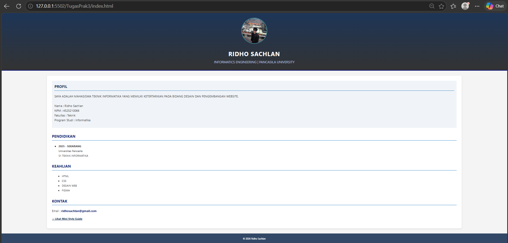
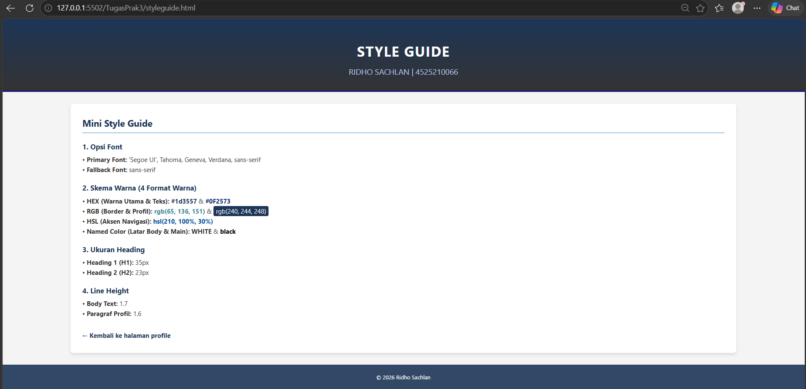

# Tugas 3 Prak Desain Web - Profil & Mini Style Guide

***Nama:*** Ridho Sachlan
***NPM:*** 4525210066

## Tugas

1. Memperbarui halaman web profil pribadi berbasis HTML5 dengan mengimplementasikan **minimal 10 properti CSS inline** serta **4 macam format penulisan warna**.
2. Menyusun **Mini Style Guide** yang memuat pilihan tipografi, skema warna utama dan aksen, variasi ukuran heading, hingga pengorganisasian *line-height*.

**Readme:** Ringkasan berkas, daftar properti & format warna, struktur *style guide*, pratinjau tangkapan layar (desktop/mobile), serta paragraf kesimpulan (150–200 kata).

## File

| File | Keterangan |
|---|---|
| `index.html` | Halaman utama profil pribadi mahasiswa berbasis CSS inline |
| `styleguide.html` | Dokumentasi Mini Style Guide tata letak dan desain |
| `img/ppridho.jpeg` | Berkas foto profil mahasiswa |
| `screenshot/` | Folder tangkapan layar tampilan desktop |

## 10 Property CSS Inline yang Digunakan

| No | Property | Contoh Pemakaian |
|---|---|---|
| 1 | `font-family` | `'Segoe UI', Tahoma, Geneva, Verdana, sans-serif` |
| 2 | `color` | `#1d3557` (header & sub-judul), `#0F2573` (teks seksi) |
| 3 | `background-color` | `#f4f4f4` (latar halaman), `WHITE` (kartu utama) |
| 4 | `font-size` | `35px` (h1), `23px` (h2), `18px` (paragraf), `16px` (daftar) |
| 5 | `line-height` | `1.7` (body), `1.6` (paragraf profil), `1.8` (daftar keahlian) |
| 6 | `text-align` | `center` (header & footer), `justify` (isi profil) |
| 7 | `padding` | `30px` (pembungkus utama), `15px` (seksi profil) |
| 8 | `margin` | `30px auto` (posisi tengah halaman) |
| 9 | `border-radius` | `50%` (foto profil), `8px` (sudut kontainer utama) |
| 10 | `box-shadow` | `0 4px 8px rgba(0, 0, 0, 0.1)` pada elemen `main` |

Properti tambahan yang diterapkan: `border`, `border-bottom`, `letter-spacing`, `text-transform`, `object-fit`, `width`, `height`, dan `opacity`.

## 4 Format Warna yang Digunakan

| Format | Contoh | Dipakai Untuk |
|---|---|---|
| Hex | `#1d3557`, `#0F2573` | Warna dominan header, footer, serta teks judul seksi |
| RGB | `rgb(65, 136, 151)`, `rgb(240, 244, 248)` | Lingkaran bingkai foto profil & latar kotak profil |
| HSL | `hsl(210, 100%, 30%)` | Warna indikator aksen navigasi link |
| Named Color | `WHITE`, `black` | Latar belakang kontainer `main` dan warna teks copyright |

## Mini Style Guide

**Font**
- Utama (Body & Judul): `'Segoe UI', Tahoma, Geneva, Verdana, sans-serif`
- Cadangan (Fallback): `sans-serif`

**Warna**
- Warna Utama: `#1d3557` (Navydark) dan `#0F2573` (Deep Blue)
- Warna Pendukung: `rgb(65, 136, 151)` dan `rgb(240, 244, 248)`
- Warna Aksen: `hsl(210, 100%, 30%)`
- Warna Dasar: `WHITE` & `#f4f4f4`

**Ukuran Heading dan Line Height**

| Elemen | Ukuran | Line Height |
|---|---|---|
| H1 (Header Utama) | 35px | Standard / Auto |
| H2 (Sub-judul Seksi) | 23px | Standard / Auto |
| Paragraf Profil | 18px | 1.6 |
| Teks Body & Daftar | 16px | 1.7 – 1.8 |

Dokumentasi visual secara mendetail dapat diakses langsung pada berkas `styleguide.html`.

## Screenshot

### Halaman Profil (`index.html`)

|  |

### Mini Style Guide (`styleguide.html`)

|  | 

## Ringkasan Kesimpulan

Melalui pengerjaan tugas praktikum ini, saya berhasil mengimplementasikan perancangan halaman profil web personal beserta dokumentasi *mini style guide* menggunakan pendekatan CSS inline. Seluruh styling diterapkan langsung ke dalam elemen HTML melalui atribut `style`. Penggunaan berbagai macam properti tampilan seperti `font-family`, `line-height`, `box-shadow`, hingga penataan *padding* dan *margin* terbukti mampu mengoptimalkan kerapian hirarki visual halaman. 

Selain itu, eksplorasi terhadap empat jenis format pewarnaan (Hex, RGB, HSL, dan Named Colors) memberikan pemahaman mendalam bahwa penulisan nilai warna dalam CSS memiliki fleksibilitas tin   ggi sesuai kebutuhan kontras maupun tingkat transparansi. Penyusunan *mini style guide* juga membantu menjaga konsistensi komponen desain antar halaman web. Pembelajaran ini memberikan wawasan bahwa meskipun CSS inline sangat praktis untuk keperluan eksperimen cepat, metode eksternal CSS tetap menjadi pilihan yang lebih terstruktur dan efisien untuk pemeliharaan kode pada skala proyek yang lebih luas.